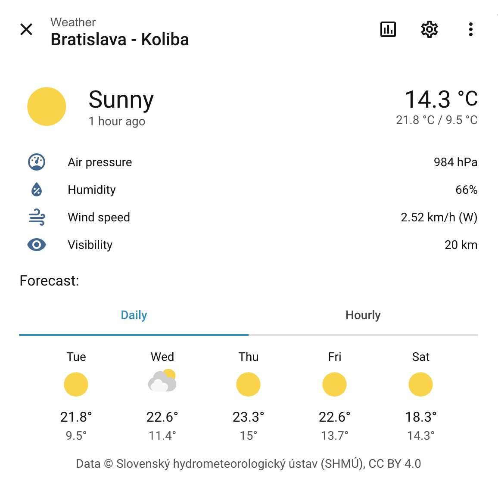
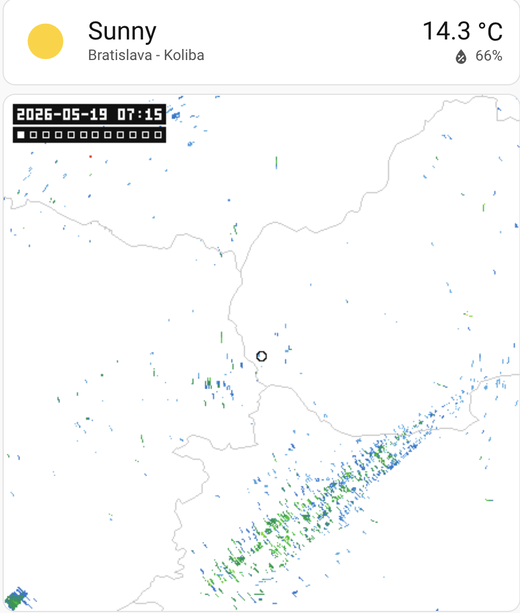

# SHMÚ Weather for Home Assistant

A Home Assistant integration for Slovak weather data published by the **Slovak Hydrometeorological Institute (SHMÚ)**.

[](https://github.com/vaind/ha-shmu/actions/workflows/ci.yml)
[](https://hacs.xyz/)

> Current conditions, the ALADIN/SHMÚ daily & hourly forecast, weather warnings and radar — decoded in pure Python, with no native dependency.

## ⚠️ Disclaimer

- This is an **unofficial, community project**. It is **not affiliated with, developed by, endorsed by, or supported by the Slovak Hydrometeorological Institute (SHMÚ)** in any way. "SHMÚ" is used only to identify the data source.
- The integration reads data from public SHMÚ endpoints that have no stable API contract; it can break if SHMÚ changes them.
- Provided **"as is", without warranty of any kind. Use at your own risk.** Do not rely on it for safety-critical decisions; always consult official SHMÚ channels for authoritative weather warnings.

## Screenshots

<table>
<tr>
<td align="center" width="50%">



<sub>**Weather entity** — current conditions, attributes & the daily / hourly forecast</sub>

</td>
<td align="center" width="50%">



<sub>**Radar** — national reflectivity composite cropped to your location</sub>

</td>
</tr>
</table>

## Features

- **Weather entity** — current conditions from a chosen SHMÚ weather station, plus the daily and hourly forecast from SHMÚ's ALADIN model.
- **Sensors** — temperature, ground temperature, humidity, pressure (the raw station reading), sea-level pressure (that reading reduced to mean sea level, comparable between stations), wind speed/gust/bearing, precipitation intensity, snow depth, visibility, global radiation, and a warning-level sensor. The raw WMO weather code and the data's release/fetch times are available as diagnostics.
- **Rain gauge precipitation** — SHMÚ also runs a second network of ~190 automatic rain gauges, about twice as dense as its ~95 weather stations, so the nearest gauge is usually closer than the nearest station.
  This sensor reports the gauge nearest your [measurement location](#configuration), with its name and distance as attributes.
  It is deliberately separate from the station's own **Precipitation** sensor — the two measure different places and are expected to disagree.
  Both precipitation sensors report **intensity in mm/h**: SHMÚ publishes only the rain that fell in one minute out of every five, so each shows the hourly rate that minute implies (the 1-minute sum × 60) rather than an amount that would leave four minutes in five out of any total.
- **Upper air (opt-in)** — a **freezing level** (the height of the 0 °C isotherm above sea level) and the **850 hPa temperature** (the standard air-mass indicator, ~1450 m up), both from the same ALADIN run as the forecast. The freezing level is *not* the snow line: snow keeps falling and melting below the isotherm, so it typically settles a few hundred metres lower. Disabled by default — enable them from the device page.
- **Weather warnings** — a binary sensor (with full alert details as attributes) that is on while a SHMÚ CAP alert's own polygon covers your measurement location.
- **Radar** — the national reflectivity composite cropped to your measurement location, as a still image, an autoplaying ~1-hour loop and a slider-scrubbable frame — plus the same three as geo-referenced overlays you can pan and zoom on a map card (see [Radar](#radar)).
- **Fresh data** — one shared fetch per cycle, timed to SHMÚ's 5-minute publish schedule (and auto-tuned to its observed publish lag), so readings arrive within minutes rather than up to a poll interval late. A station that drops out of one snapshot keeps its last reading until it is genuinely stale, instead of flickering to unavailable.

## Installation (HACS)

It is part of the **default HACS store** — no custom repository needed.

1. HACS → search for **SHMÚ Weather** → *Download*, then restart Home Assistant.

   [](https://my.home-assistant.io/redirect/hacs_repository/?owner=vaind&repository=ha-shmu&category=integration)

2. *Settings → Devices & Services → Add Integration → SHMÚ Weather*, then fill in the options below.

   [](https://my.home-assistant.io/redirect/config_flow_start/?domain=shmu)

It is distributed through HACS rather than Home Assistant core because part of the current condition is read from the SHMÚ website — the open-data observations carry no cloud cover — and because it bundles its own SHMÚ client (see [Why HACS](CONTRIBUTING.md#why-hacs-and-not-home-assistant-core)).

## Configuration

| Option | What it does |
|---|---|
| **Station** | The SHMÚ automatic weather station whose observations drive the current conditions and sensors. The one nearest your Home Assistant location is preselected; any of the 94 can be picked. The 27 *synoptic* stations (the ones whose observations are exchanged with weather services worldwide), marked ★, report the most; the others mostly report temperature, humidity, wind and precipitation, with pressure, present weather and visibility at only some of them (see [Stations](#stations)). To follow another station, add the integration again — each station is its own device. |
| **Name** | The device name, which also prefixes every entity ID. Defaults to your Home Assistant location name (e.g. *Home* → `weather.home`). |
| **Measurement location** | The point used for the forecast, radar crop, warning relevance and nearest rain gauge: *Same as the station*, *Home Assistant location*, or *Custom location* picked on a map. |

The measurement location can be changed later under *Settings → Devices & Services → SHMÚ Weather → Configure*. The station cannot — remove and re-add the integration to switch it.

If you change the measurement location and a different rain gauge becomes the nearest, the rain-gauge sensor keeps its history rather than starting a new one: a long-term graph spanning that change mixes both gauges, and the gauge named in the attributes is the one in use now.

## Stations

Every station SHMÚ publishes in its open-data observation feed can be picked, but they do not all measure the same things.
The 27 **synoptic** stations (★ in the station list) report the fullest set.
The other ~70 all report temperature, humidity, wind and precipitation; roughly a third also report pressure, and fewer still present weather, visibility or global radiation.
A sensor for a quantity the chosen station does not measure stays *unknown*.

- **Sea-level pressure** needs the station's elevation, which is known for about 70 of the stations.
  Where it is not (mostly SHMÚ's eastern regional stations), the sea-level pressure sensor is not created and the weather entity shows no pressure; the raw **Pressure** sensor still reports the station's own reading if it measures one.
- **The weather condition** at a station that reports no present weather comes mostly from the ALADIN model's current-hour cloud cover and precipitation, since the SHMÚ website's cloud observations rarely cover these stations either.
  The weather entity's `condition_source` attribute shows which source won.

## Radar

The SHMÚ national radar reflectivity composite (ODIM_H5, a new frame every ~5 min), decoded in pure Python — no native dependency.
Each frame is rendered two ways from one download: cropped to the vicinity of your measurement location, with country borders and a marker drawn on so the picture is self-locating in a plain card; and whole-country at native resolution with no decoration, for [draping over a map card](#zoomable-radar-on-a-map).
It is **national data**, so the radar entities stay available even if your station momentarily drops out of an observation snapshot.
The colour ramp is reflectivity (rain/storm intensity); this is *not* cloud cover.

Entities (grouped under the station device; `<device>` is the device name you chose during setup, e.g. `home`):

| Entity | What it shows |
|---|---|
| `image.<device>_radar` | The **latest** single frame. Attributes: `product`, `max_dbz` (peak reflectivity — a handy "is it raining?" signal), `center_*` and `bbox_*`. |
| `image.<device>_radar_loop` | An **autoplaying ~1-hour loop** (the last 12 frames, animated PNG). Every frame is stamped with its valid time in your Home Assistant timezone, plus a row of step markers under it that fills in across the hour and resets when the loop wraps. |
| `image.<device>_radar_frame` | A **single buffered frame**, chosen by the scrubber below — for manually stepping through the loop. |
| `number.<device>_radar_frame_selector` | The **scrubber** (slider). Reads like a timeline: `0` on the **right** is live/newest; drag **left** into the past — `-1` ≈ 5 min ago … down to `-(frames-1)` for the oldest buffered frame. |
| `image.<device>_radar_map` | The latest frame **for a map card**: the whole country at the radar's native ~0.3 km resolution, with nothing drawn on it and transparent where there is no echo. `bbox_*` is the composite's own corners, and `max_dbz` is the strongest echo *anywhere in the country* rather than near you. |
| `image.<device>_radar_map_loop` | The same ~1-hour loop, for a map card. It carries no timestamp and no step markers: a map overlay is drawn in ground coordinates, so anything baked into a corner of the picture would sit in the terrain and stretch with the zoom. The entity's state is the newest frame's time. |
| `image.<device>_radar_map_frame` | The scrubbed frame, for a map card — driven by the same slider as `radar_frame`. |

The scrubber and the two frames it drives (`radar_frame_selector`, `radar_frame`, `radar_map_frame`) are **provisional**: they are likely to be replaced by frame-by-frame playback in the map plugin itself ([#52](https://github.com/vaind/ha-shmu/issues/52)).
The other radar entities are not affected.

### Example dashboard card

A plain Lovelace card — no custom frontend resources — pairing the scrubbable frame with its slider:

```yaml
type: vertical-stack
cards:
  - type: picture-entity
    entity: image.<device>_radar_frame
    show_state: false
    show_name: false
  - type: entities
    entities:
      - entity: number.<device>_radar_frame_selector
```

For a hands-off "just watch it move" view, use `image.<device>_radar_loop` in a plain `picture-entity` card instead — it animates on its own.

### Zoomable radar on a map

The pictures above are fixed crops, so there is nothing to zoom into.
The `*_radar_map*` entities are the same frames rendered for a map instead: the whole national composite at the radar's own resolution, undecorated, and geo-referenced by the `bbox_*` attributes.
Draping one over a Leaflet map card gives you pan and zoom, and sets the echo against towns, roads and terrain — none of which a radar picture can show on its own.
Alignment is exact, not approximate: the SHMÚ grid and web maps are both spherical Mercator, so every pixel lands where the map itself puts that coordinate.

This needs one custom card — [ha-map-card](https://github.com/nathan-gs/ha-map-card) by nathan-gs — which you install once from HACS (*Frontend* → search for **Map card**).
The plugin that puts the radar on it **ships with this integration** and is served at `/shmu_static/radar-map-overlay.js`, so there is nothing else to download and no Lovelace resource to register.

```yaml
type: custom:map-card
focus_entity: zone.home # centre on your Home Assistant location
zoom: 8
card_size: 8
entities:
  - zone.home # optional: also draw a marker there
plugins:
  - name: shmu-radar
    url: /shmu_static/radar-map-overlay.js
    options:
      entity: image.<device>_radar_map_loop
      opacity: 0.6
```

The card has no home-location default of its own, so give it `focus_entity` (or fixed coordinates).
With neither, it fits the bounds of the entity markers you listed and *ignores* `zoom` — which for a single marker means it opens at street level, far too close for a radar view.
To pin the view somewhere other than home, use `x` and `y` instead: `x` is the **latitude** and `y` the longitude, whichever way round the card's own option table lists them.

Plugin options: `entity` (required) is any of the three map entities, `opacity` defaults to `0.6`, and `attribution` overrides the SHMÚ credit shown in the map's corner.
Point `entity` at `image.<device>_radar_map_frame` and add the scrubber card to the same view to step through the last hour on the map.
That pairing is provisional, like the scrubber itself — see the note under the radar entities.

On a wall dashboard, mind the bandwidth: the animated map loop is ~330 KB and the browser re-fetches it every 5 minutes while the card is open, so prefer the still `image.<device>_radar_map` (~30 KB) where that matters.

## Removing the integration

1. *Settings → Devices & Services → SHMÚ Weather → ⋮ → Delete* for each configured station. This removes its device, entities and history.
2. Optionally, in HACS → *SHMÚ Weather* → ⋮ → *Remove*, then restart Home Assistant to delete the integration files.

No external account or credential exists, so nothing else needs cleaning up.

## Data source & attribution

Weather and climate data © **Slovenský hydrometeorologický ústav (SHMÚ)**, provided via <https://opendata.shmu.sk/> under [CC BY 4.0](https://creativecommons.org/licenses/by/4.0/).

## License

Code is MIT licensed (see [LICENSE](LICENSE)). SHMÚ data retains its CC BY 4.0 license and must be attributed accordingly.
