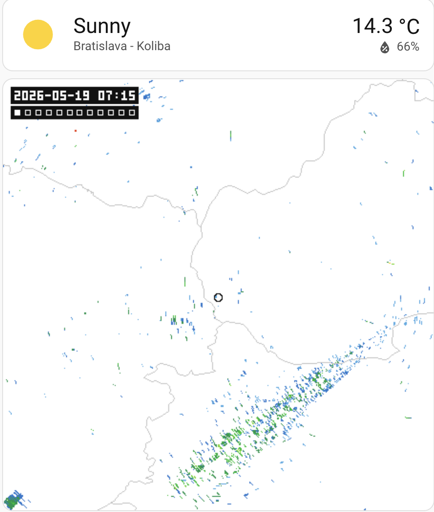

# SHMÚ Weather for Home Assistant

A Home Assistant integration for Slovak weather data published by the **Slovak Hydrometeorological Institute (SHMÚ)**.

[](https://github.com/vaind/ha-shmu/actions/workflows/ci.yml)
[](https://www.hacs.xyz/docs/marketplace/)

> Current conditions, the ALADIN/SHMÚ daily & hourly forecast, weather warnings and radar — decoded in pure Python, with no native dependency.

## ⚠️ Disclaimer

This is an **unofficial community project**, not affiliated with or endorsed by the Slovak Hydrometeorological Institute (SHMÚ).
Do not rely on it for safety-critical decisions: consult SHMÚ's official channels for authoritative weather warnings.

## Screenshots

<table>
<tr>
<td align="center" width="50%">


<sub>**Weather entity** — current conditions, attributes & the daily / hourly forecast</sub>

</td>
<td align="center" width="50%">



<sub>**Radar** — national reflectivity composite cropped to your location</sub>

</td>
</tr>
</table>

## Features

- **Weather entity** — current conditions from a chosen SHMÚ weather station, plus the daily and hourly forecast from SHMÚ's ALADIN model.
- **Sensors** — temperature, ground temperature, humidity, pressure (the raw station reading), sea-level pressure (comparable between stations), wind speed/gust/bearing, precipitation intensity, snow depth, visibility, global radiation and warning level; which of them a station has depends on what it measures (see [Stations](#stations)). The raw WMO weather code (disabled by default) and the data's release/fetch times are diagnostics.
- **Rain gauge precipitation** — SHMÚ also runs a second network of ~190 automatic rain gauges, about twice as dense as its weather stations, so the nearest gauge is usually closer than the nearest station.
  This sensor reports the gauge nearest your [measurement location](#configuration), with its name and distance as attributes.
  It is deliberately separate from the station's own **Precipitation** sensor — the two measure different places and are expected to disagree.
  Both precipitation sensors report **intensity in mm/h**: SHMÚ publishes only the rain that fell in one minute out of every five, so each shows the hourly rate that minute implies (the 1-minute sum × 60) rather than an amount that would leave four minutes in five out of any total.
- **Upper air (opt-in)** — a **freezing level** (the height of the 0 °C isotherm above sea level) and the **850 hPa temperature** (the standard air-mass indicator, ~1450 m up), both from the same ALADIN run as the forecast. The freezing level is *not* the snow line: snow keeps falling and melting below the isotherm, so it typically settles a few hundred metres lower. Disabled by default — enable them from the device page.
- **Weather warnings** — a binary sensor (with full alert details as attributes) that is on while a SHMÚ CAP alert's area covers your measurement location.
- **Radar** — the national reflectivity composite cropped to your measurement location, as a still image, an autoplaying ~1-hour loop and a slider-scrubbable frame — plus the same three as geo-referenced overlays you can pan and zoom on a map card (see [Radar](#radar)).
- **Fresh data** — one shared fetch per cycle, timed to SHMÚ's 5-minute publish schedule (and auto-tuned to its observed publish lag), so readings arrive within minutes rather than up to a poll interval late. A station that drops out of one snapshot keeps its last reading until it is genuinely stale, instead of flickering to unavailable.

## Installation (Marketplace or HACS)

It is listed in the default catalog of the Home Assistant Marketplace, which replaced HACS in Home Assistant 2026.11, so no custom repository is needed. Requires Home Assistant 2026.3 or newer.

1. *Settings → Marketplace* (HACS before Home Assistant 2026.11) → search for **SHMÚ Weather** → *Download*, then restart Home Assistant if asked to.

   The button below opens the repository in whichever of the two your Home Assistant has.

   [](https://my.home-assistant.io/redirect/hacs_repository/?owner=vaind&repository=ha-shmu&category=integration)

2. *Settings → Devices & Services → Add Integration → SHMÚ Weather*, then fill in the options below.

   [](https://my.home-assistant.io/redirect/config_flow_start/?domain=shmu)

It is distributed through the Marketplace rather than Home Assistant core because part of the current condition is read from the SHMÚ website — the open-data observations carry no cloud cover — and because it bundles its own SHMÚ client (see [Why HACS](CONTRIBUTING.md#why-hacs-and-not-home-assistant-core)).

## Configuration

| Option | What it does |
|---|---|
| **Station** | The SHMÚ automatic weather station whose observations drive the current conditions and sensors. The one nearest your Home Assistant location is preselected; any of the 94 can be picked, and the *synoptic* ones, marked ★, report the most (see [Stations](#stations)). To follow another station, add the integration again — each station is its own device. |
| **Name** | The device name, which also prefixes every entity ID. Defaults to your Home Assistant location name (e.g. *Home* → `weather.home`). |
| **Measurement location** | The point used for the forecast, radar crop, warning relevance and nearest rain gauge: *Same as the station*, *Home Assistant location*, or *Custom location* picked on a map. |

The measurement location can be changed later under *Settings → Devices & Services → SHMÚ Weather → Configure* (the rain-gauge sensor keeps its history if that switches it to another gauge). The station cannot — remove and re-add the integration to switch it.

## Stations

Every station SHMÚ publishes in its open-data observation feed can be picked, but they do not all measure the same things.
The 26 **synoptic** stations (★ in the station list, the ones whose observations are exchanged with weather services worldwide) report the fullest set.
The other 68 all report temperature, humidity, wind and precipitation; roughly a third also report pressure, and fewer still present weather, visibility or global radiation.
A sensor for a quantity the chosen station does not measure is *unavailable*, while the station's other sensors keep updating.
- **Sea-level pressure** needs a barometer and the station's elevation, and about 50 stations lack one or the other.
  For those, the sea-level pressure sensor and the weather entity show the value of the nearest station within 40 km that has it, leaving out mountain stations (1000 m and above), whose reduction to sea level is the least reliable.
  Reduced to sea level, pressure barely changes over that distance: measured across SHMÚ's stations, two of them typically differ by under 1 hPa.
  The sensor's `source_name` and `source_distance_km` attributes name the station the value came from (0 km for the chosen station's own); with no such station in range it is *unavailable*.
  The raw **Pressure** sensor always reports only the chosen station's own reading.
- **The weather condition** is taken from the best source available, in this order: the weather observed on the SHMÚ website, the station's own present-weather report, the radar, the cloud cover observed on the website, and the ALADIN model.
  Most non-synoptic stations have neither of the first two, so their condition comes from the radar and the model.
  A radar echo of 20 dBZ or more within about 1 km of the station means it is precipitating, as rain, sleet or snow depending on the temperature; no echo there overrules the model when it forecasts rain.
  The radar alone never reports a downpour or a thunderstorm, but it keeps one the model forecasts when it confirms precipitation.  The weather entity's `condition_source` attribute shows which source won (`website`, `stav_poc`, `radar` or `aladin`).

## Radar

The SHMÚ national radar reflectivity composite (ODIM_H5, a new frame every ~5 min), decoded in pure Python — no native dependency.
Each frame is rendered two ways from one download: cropped to the vicinity of your measurement location, with country borders and a marker drawn on so the picture is self-locating in a plain card; and whole-country at native resolution with no decoration, for [draping over a map card](#zoomable-radar-on-a-map).
It is **national data**, so the radar entities stay available even if your station momentarily drops out of an observation snapshot.
The colour ramp is reflectivity (rain/storm intensity); this is *not* cloud cover.

Entities (grouped under the station device; `<device>` is the device name you chose during setup, e.g. `home`):

| Entity | What it shows |
|---|---|
| `image.<device>_radar` | The **latest** single frame. Attributes: `product`, `max_dbz` (peak reflectivity — a handy "is it raining?" signal), `center_*` and `bbox_*`. |
| `image.<device>_radar_loop` | An **autoplaying ~1-hour loop** (the last 12 frames, animated PNG). Every frame is stamped with its valid time in your Home Assistant timezone, plus a row of step markers under it that fills in across the hour and resets when the loop wraps. |
| `image.<device>_radar_frame` | A **single buffered frame**, chosen by the scrubber below — for manually stepping through the loop. |
| `number.<device>_radar_frame_selector` | The **scrubber** (slider). Reads like a timeline: `0` on the **right** is live/newest; drag **left** into the past — `-1` ≈ 5 min ago … down to `-(frames-1)` for the oldest buffered frame. |
| `image.<device>_radar_map` | The latest frame **for a map card**: the whole country at the radar's native ~0.3 km resolution, with nothing drawn on it and transparent where there is no echo. `bbox_*` is the composite's own corners, and `max_dbz` is the strongest echo *anywhere in the country* rather than near you. |
| `image.<device>_radar_map_loop` | The same ~1-hour loop, for a map card. It carries no timestamp and no step markers: a map overlay is drawn in ground coordinates, so anything baked into a corner of the picture would sit in the terrain and stretch with the zoom. The entity's state is the newest frame's time. |
| `image.<device>_radar_map_frame` | The scrubbed frame, for a map card — driven by the same slider as `radar_frame`. |

The scrubber and the two frames it drives (`radar_frame_selector`, `radar_frame`, `radar_map_frame`) are **provisional**: they are likely to be replaced by frame-by-frame playback in the map plugin itself ([#52](https://github.com/vaind/ha-shmu/issues/52)).
The other radar entities are not affected.

### Example dashboard card

A plain Lovelace card — no custom frontend resources — pairing the scrubbable frame with its slider:

```yaml
type: vertical-stack
cards:
  - type: picture-entity
    entity: image.<device>_radar_frame
    show_state: false
    show_name: false
  - type: entities
    entities:
      - entity: number.<device>_radar_frame_selector
```

For a hands-off "just watch it move" view, use `image.<device>_radar_loop` in a plain `picture-entity` card instead — it animates on its own.

### Zoomable radar on a map

The pictures above are fixed crops, so there is nothing to zoom into.
The `*_radar_map*` entities are the same frames rendered for a map instead: the whole national composite at the radar's own resolution, undecorated, and geo-referenced by the `bbox_*` attributes.
Draping one over a Leaflet map card gives you pan and zoom, and sets the echo against towns, roads and terrain — none of which a radar picture can show on its own.
Alignment is exact, not approximate: the SHMÚ grid and web maps are both spherical Mercator, so every pixel lands where the map itself puts that coordinate.

This needs one custom card — [ha-map-card](https://github.com/nathan-gs/ha-map-card) by nathan-gs — which you install once from the Marketplace or HACS (search for **Map card**).
The plugin that puts the radar on it **ships with this integration** and is served at `/shmu_static/radar-map-overlay.js`, so there is nothing else to download and no Lovelace resource to register.

```yaml
type: custom:map-card
focus_entity: zone.home # centre on your Home Assistant location
zoom: 8
card_size: 8
entities:
  - zone.home # optional: also draw a marker there
plugins:
  - name: shmu-radar
    url: /shmu_static/radar-map-overlay.js
    options:
      entity: image.<device>_radar_map_loop
      opacity: 0.6
```

The card has no home-location default of its own, so give it `focus_entity` (or fixed coordinates).
With neither, it fits the bounds of the entity markers you listed and *ignores* `zoom` — which for a single marker means it opens at street level, far too close for a radar view.
To pin the view somewhere other than home, use `x` and `y` instead: `x` is the **latitude** and `y` the longitude, whichever way round the card's own option table lists them.

Plugin options: `entity` (required) is any of the three map entities, `opacity` defaults to `0.6`, and `attribution` overrides the SHMÚ credit shown in the map's corner.
Point `entity` at `image.<device>_radar_map_frame` and add the scrubber card to the same view to step through the last hour on the map.
That pairing is provisional, like the scrubber itself — see the note under the radar entities.

On a wall dashboard, mind the bandwidth: the animated map loop is ~330 KB and the browser re-fetches it every 5 minutes while the card is open, so prefer the still `image.<device>_radar_map` (~30 KB) where that matters.

## How data is updated

The integration polls SHMÚ every 5 minutes, in one shared fetch for all entities, timed just after SHMÚ's own 5-minute publishing schedule.
How fresh each entity is depends on how often SHMÚ publishes its source:

| Data | New data upstream | Notes |
|---|---|---|
| Station observations and rain gauges | every 5 minutes | The newest reading in a file is about 2 minutes old when SHMÚ publishes it. |
| Radar | every 5 minutes | A frame appears 5 to 8 minutes after the time it shows. |
| Observed weather and cloud cover (SHMÚ website) | every hour | Published about 2 minutes past the hour. |
| Warnings | whenever SHMÚ issues them | Checked on every poll. |
| ALADIN forecast | four runs a day (00, 06, 12 and 18 UTC) | A run becomes available 3 to 5 hours after its start. |

When a fetch fails, the integration keeps the last data it has and tries again on the next poll.
It does not keep that data forever:

- A station or rain-gauge reading is kept for 30 minutes, after which its sensors become *unavailable*.
- The weather observed on the website is set aside after an hour, and the condition then comes from the station, the radar and the forecast model.
- A radar frame older than 20 minutes no longer decides the weather condition.

## Use cases and examples

In the examples, replace `<device>` with the device name you chose during setup (e.g. `home`).

**Get notified when a warning comes into force at your location.**
The warning binary sensor lists the active warnings in its `warnings` attribute, worst first, each with `event`, `severity`, `awareness_level`, `awareness_type`, `headline`, `onset`, `expires` and `areas`.

```yaml
automation:
  - alias: Notify on a SHMÚ weather warning
    triggers:
      - trigger: state
        entity_id: binary_sensor.<device>_weather_warning
        to: "on"
    actions:
      - action: notify.notify
        data:
          title: SHMÚ weather warning
          message: "{{ state_attr('binary_sensor.<device>_weather_warning', 'warnings')[0].headline }}"
```

To react only to the more serious warnings, trigger on `sensor.<device>_warning_level` changing to `orange` or `red` instead.

**Retract an awning or close a roof window when it starts to rain.**
The rain-gauge sensor is usually the closest measurement to your home, and any value above zero means the gauge collected rain in the last reported minute.

```yaml
automation:
  - alias: Retract the awning when it rains
    triggers:
      - trigger: numeric_state
        entity_id: sensor.<device>_rain_gauge_precipitation
        above: 0
    actions:
      - action: cover.close_cover
        target:
          entity_id: cover.awning
```

The gauge reports rain only once it has fallen, up to a few minutes earlier.
For an earlier signal, watch the radar on a dashboard, since `max_dbz` of `image.<device>_radar` covers the whole picture rather than your location.

**Warn about ground frost.**
The ground temperature is measured just above the ground, where frost forms before the air temperature at 2 m reaches zero.

```yaml
automation:
  - alias: Ground frost warning
    triggers:
      - trigger: numeric_state
        entity_id: sensor.<device>_ground_temperature
        below: 0
    actions:
      - action: notify.notify
        data:
          message: Ground frost at the weather station - cover the plants.
```

**Show the forecast on a dashboard.**
The weather entity works with the built-in `weather-forecast` card and any card that reads Home Assistant's daily or hourly forecast.
The radar cards are described under [Radar](#radar).

## Known limitations

- **The forecast reaches about four days ahead.**
  SHMÚ publishes the ALADIN model hourly to at most 102 hours, and the daily forecast lists only the days the model covers to their end.
  SHMÚ publishes its longer-range forecasts as pictures only, so the integration cannot read them.
- **There is no rainfall total.**
  Both precipitation sensors report an intensity in mm/h taken from one minute in every five, so summing them does not give a daily amount.
- **Readings come from the station, not from your home.**
  The station can be tens of kilometres away and at a different altitude.
  Only the forecast, the radar, the warnings and the rain gauge follow the measurement location.
- **A station reports only what it measures.**
  Many stations have no barometer, present-weather sensor or visibility sensor, and those sensors stay *unavailable* (see [Stations](#stations)).
- **The weather condition is a best estimate.**
  At most stations nobody observes the sky, so the condition comes from the radar and the forecast model, and the radar alone never reports a thunderstorm.
- **The station cannot be changed after setup.**
  Add the integration again for another station and remove the old one.
- **Slovakia only.**
  The stations, the forecast grid and the warnings cover Slovakia, and the radar a little beyond its borders.
- **No air quality.**
  SHMÚ does not publish it as open data.
- **The map radar loop shows no time**, because the browser plays the animation on its own and the card cannot tell which frame is on screen.
- **SHMÚ can change its data without notice.**
  Its public endpoints have no stable API contract, so a change can break a sensor until the integration is updated.

## Troubleshooting

**A sensor is unavailable.**
If it is always unavailable, the station does not measure that quantity: pick a ★ station for the fullest set.
If all of the station's sensors are unavailable, SHMÚ has published no new reading for that station for 30 minutes.
Check that <https://opendata.shmu.sk/meteorology/climate/now/data/> lists a file from the last few minutes.
The radar, forecast and warning entities do not depend on the station and keep working.

**The log shows `SHMÚ … unavailable, keeping previous`.**
One of SHMÚ's sources failed to answer.
The integration keeps the previous data, logs the message once and logs again when the source is back, so an occasional message needs no action.

**The weather condition looks wrong.**
The weather entity's `condition_source` attribute names the source that decided it (`website`, `stav_poc`, `radar` or `aladin`).
The diagnostics download shows every source's candidate under `derived_condition`.

**Home Assistant raised a repair about a changed unit or mean type.**
Version 0.11.0 changed the precipitation sensors to mm/h and the wind bearing to a wind direction.
Delete the old statistics for those sensors under *Developer tools → Statistics*, as the [changelog](CHANGELOG.md) describes.

**The radar does not appear on the map card.**
Check that [ha-map-card](https://github.com/nathan-gs/ha-map-card) is installed, that the plugin `url` is exactly `/shmu_static/radar-map-overlay.js` and that `entity` is one of the three `image.<device>_radar_map*` entities.
With no rain anywhere in the country the overlay is fully transparent, so compare with `image.<device>_radar`.

**Reporting a problem.**
Open an [issue](https://github.com/vaind/ha-shmu/issues) and attach the diagnostics: *Settings → Devices & Services → SHMÚ Weather → ⋮ → Download diagnostics*.
It contains the station and the raw SHMÚ data behind every entity, and neither credentials nor your home coordinates.
For a problem that comes and goes, turn on *Enable debug logging* in the same menu, wait for it to happen again and attach the log too.

## Versioning

The integration follows [Semantic Versioning](https://semver.org/).
From version 1.0 on, a breaking change to any of the following comes only with a new major version and is announced in the [changelog](CHANGELOG.md):

- the entities, their entity IDs and unique IDs
- the meaning and unit of each entity's state
- the entity attributes described in this README
- the configuration options
- the map plugin's URL and options

Not covered, and free to change in any release:

- the scrubber entities marked provisional under [Radar](#radar)
- the content of the diagnostics download
- log messages
- how the weather condition is resolved from its sources, which keeps improving
- the Python API of the bundled SHMÚ client

A change that SHMÚ forces by changing or withdrawing its data may arrive in a minor version.

## Removing the integration

1. *Settings → Devices & Services → SHMÚ Weather → ⋮ → Delete* for each configured station. This removes its device, entities and history.
2. Optionally, in *Settings → Marketplace* (or HACS) → *SHMÚ Weather* → ⋮ → *Remove*, then restart Home Assistant to delete the integration files.

No external account or credential exists, so nothing else needs cleaning up.

## Data source & attribution

Weather and climate data © **Slovenský hydrometeorologický ústav (SHMÚ)**, provided via <https://opendata.shmu.sk/> under [CC BY 4.0](https://creativecommons.org/licenses/by/4.0/).

## License

Code is MIT licensed (see [LICENSE](LICENSE)). SHMÚ data retains its CC BY 4.0 license and must be attributed accordingly.
