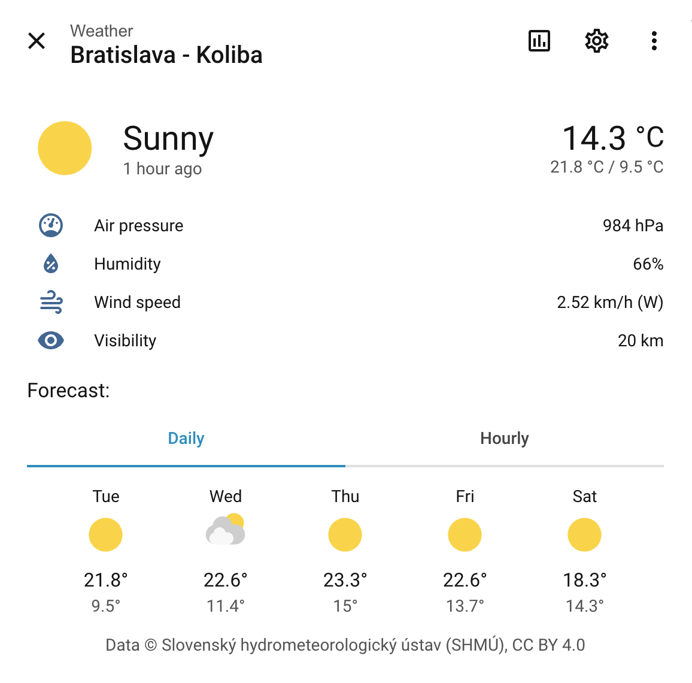

# SHMÚ Weather for Home Assistant

A Home Assistant integration for Slovak weather data published by the **Slovak Hydrometeorological Institute (SHMÚ)**.

[](https://github.com/vaind/ha-shmu/actions/workflows/ci.yml)
[](https://www.hacs.xyz/docs/marketplace/)

> Current conditions, the ALADIN daily and hourly forecast, weather warnings and radar, decoded in pure Python with no native dependency.

## ⚠️ Disclaimer

This is an **unofficial community project**, not affiliated with or endorsed by the Slovak Hydrometeorological Institute (SHMÚ).
Do not rely on it for safety-critical decisions: consult SHMÚ's official channels for authoritative weather warnings.

## Screenshots

<table>
<tr>
<td align="center" width="50%">



<sub>**Weather entity**: current conditions, attributes and the daily and hourly forecast</sub>

</td>
<td align="center" width="50%">


<sub>**Radar**: the national reflectivity composite cropped to your location</sub>

</td>
</tr>
</table>

## Features

- **Weather entity**: current conditions from a SHMÚ weather station you pick, and the daily and hourly forecast from SHMÚ's ALADIN model.
- **Sensors**: temperature, ground temperature, humidity, pressure (the raw station reading), sea-level pressure (comparable between stations), wind speed, gust and bearing, precipitation intensity, snow depth, visibility, global radiation and warning level. Which of them a station has depends on what it measures (see [Stations](#stations)). The raw WMO weather code (disabled by default) and the data's release and fetch times are diagnostics.
- **Rain gauge precipitation**: SHMÚ also runs ~190 automatic rain gauges, a separate network about twice as dense as its weather stations.
  This sensor reports the gauge nearest your [measurement location](#configuration), with its name and distance as attributes.
  It is separate from the station's own **Precipitation** sensor on purpose, because the two measure different places and are expected to disagree.
  Both report **intensity in mm/h**: SHMÚ publishes only the rain of one minute in every five, so each sensor shows the hourly rate that minute implies (the 1-minute sum × 60).
- **Upper air (opt-in)**: the **freezing level** (the height of the 0 °C isotherm above sea level) and the **850 hPa temperature** (the standard air-mass indicator, ~1450 m up), from the same ALADIN run as the forecast. The freezing level is *not* the snow line, which usually sits a few hundred metres lower. Enable them from the device page.
- **Weather warnings**: a binary sensor that is on while a SHMÚ warning covers your measurement location, with each warning's full text in its attributes (see [Weather warnings](#weather-warnings)).
- **Warnings calendar**: the same warnings as calendar events, including those SHMÚ has issued for later, for the *Calendar* panel and for automations that act before a warning comes into force (see [Warnings calendar](#warnings-calendar)).
- **Radar**: the national reflectivity composite cropped to your measurement location as a still image, a ~1-hour loop and a scrubbable frame, plus the same three as overlays you can pan and zoom on a map card (see [Radar](#radar)).
- **Fresh data**: one shared fetch per cycle, timed to SHMÚ's 5-minute publishing schedule and tuned to its observed publishing delay, so readings arrive within minutes. A station missing from one snapshot keeps its last reading until it is genuinely stale instead of flickering to unavailable.

## Installation (Marketplace or HACS)

The integration is in the default catalog of the Home Assistant Marketplace, which replaced HACS in Home Assistant 2026.11, so no custom repository is needed. It requires Home Assistant 2026.3 or newer.

1. *Settings → Marketplace* (HACS before Home Assistant 2026.11) → search for **SHMÚ Weather** → *Download*, then restart Home Assistant if asked to.

   The button below opens the repository in whichever of the two your Home Assistant has.

   [](https://my.home-assistant.io/redirect/hacs_repository/?owner=vaind&repository=ha-shmu&category=integration)

2. *Settings → Devices & Services → Add Integration → SHMÚ Weather*, then fill in the options below.

   [](https://my.home-assistant.io/redirect/config_flow_start/?domain=shmu)

It ships through the Marketplace rather than Home Assistant core because part of the current condition is read from the SHMÚ website, and because it bundles its own SHMÚ client (see [Why HACS](CONTRIBUTING.md#why-hacs-and-not-home-assistant-core)).

## Configuration

| Option | What it does |
|---|---|
| **Station** | The SHMÚ automatic weather station whose observations drive the current conditions and sensors. The one nearest your Home Assistant location is preselected, and the *synoptic* stations, marked ★, report the most (see [Stations](#stations)). For another station, add the integration again: each station is its own device. |
| **Name** | The device name, which also prefixes every entity ID. Defaults to your Home Assistant location name (e.g. *Home* → `weather.home`). |
| **Measurement location** | The point used for the forecast, the radar crop, warning relevance and the nearest rain gauge: *Same as the station*, *Home Assistant location*, or *Custom location* picked on a map. |

You can change the measurement location later under *Settings → Devices & Services → SHMÚ Weather → Configure*, and the rain-gauge sensor keeps its history if that moves it to another gauge.
The station cannot be changed: remove the integration and add it again.

## Stations

You can pick any of the 94 stations in SHMÚ's open-data observation feed that have known coordinates, but they do not all measure the same things.
The 26 **synoptic** stations (★, whose observations are exchanged with weather services worldwide) report the fullest set.
The other 68 all report temperature, humidity, wind and precipitation. About a third also report pressure, and fewer still present weather, visibility or global radiation.
A sensor for a quantity the station does not measure is *unavailable*, while the station's other sensors keep updating.

- **Sea-level pressure** needs a barometer and the station's elevation, and about 50 stations lack one or the other.
  For those, the sensor and the weather entity show the value of the nearest station within 40 km that has one, leaving out mountain stations (1000 m and above), whose reduction to sea level is the least reliable.
  Reduced to sea level, two of SHMÚ's stations typically differ by under 1 hPa over that distance.
  The `source_name` and `source_distance_km` attributes name the station the value came from (0 km for your station's own). With no such station in range, the sensor is *unavailable*.
  The raw **Pressure** sensor always reports only your station's own reading.
- **The weather condition** comes from the best source available, in this order: the weather observed on the SHMÚ website, the station's own present-weather report, the radar, the cloud cover observed on the website, and the ALADIN model.
  Most non-synoptic stations have neither of the first two, so their condition comes from the radar and the model.
  A radar echo of 20 dBZ or more within about 1 km of the station means precipitation, as rain, sleet or snow by temperature. No echo there overrules the model when it forecasts rain.
  The radar alone never reports a downpour or a thunderstorm, but it keeps one the model forecasts when it confirms precipitation.
  The weather entity's `condition_source` attribute shows which source won (`website`, `stav_poc`, `radar` or `aladin`).

## Radar

The integration decodes SHMÚ's national radar reflectivity composite (a new frame every ~5 min) and renders each frame two ways.
One is cropped to your measurement location, with country borders and a marker drawn on, for a plain picture card.
The other is the whole country at native resolution with nothing drawn on, for [a map card](#zoomable-radar-on-a-map).
The radar is national data, so its entities stay available even when your station drops out of an observation snapshot.
The colours show reflectivity (rain and storm intensity), *not* cloud cover.

The entities belong to the station device, where `<device>` is the device name you chose during setup (e.g. `home`), and their attributes are listed under [Entity attributes](#entity-attributes):

| Entity | What it shows |
|---|---|
| `image.<device>_radar` | The **latest** frame. |
| `image.<device>_radar_loop` | An **autoplaying ~1-hour loop** of the last 12 frames (animated PNG). Each frame is stamped with its time in your Home Assistant timezone, over a row of step markers that fills in across the hour. |
| `image.<device>_radar_frame` | The **buffered frame** the scrubber below selects, for stepping through the loop by hand. |
| `number.<device>_radar_frame_selector` | The **scrubber** (slider). `0`, on the **right**, is the newest frame. Drag **left** into the past: `-1` is ≈ 5 min ago, down to `-(frames-1)` for the oldest buffered frame. |
| `image.<device>_radar_map` | The latest frame **for a map card**: the whole country at the radar's native ~0.3 km resolution, transparent where there is no echo. `bbox_*` holds the composite's corners, and `max_dbz` is the strongest echo in the whole country. |
| `image.<device>_radar_map_loop` | The ~1-hour loop for a map card. It has no timestamp or step markers, because anything drawn on a map overlay would sit in the terrain and stretch with the zoom. The entity's state is the newest frame's time. |
| `image.<device>_radar_map_frame` | The scrubbed frame for a map card, driven by the same slider as `radar_frame`. |

The scrubber and the two frames it drives (`radar_frame_selector`, `radar_frame`, `radar_map_frame`) are **provisional** and likely to be replaced by frame-by-frame playback in the map plugin ([#52](https://github.com/vaind/ha-shmu/issues/52)).
The other radar entities are not affected.

### Example dashboard card

A plain card, with no custom frontend resources, pairing the scrubbable frame with its slider:

```yaml
type: vertical-stack
cards:
  - type: picture-entity
    entity: image.<device>_radar_frame
    show_state: false
    show_name: false
  - type: entities
    entities:
      - entity: number.<device>_radar_frame_selector
```

To just watch it move, put `image.<device>_radar_loop` in a plain `picture-entity` card instead, and it animates on its own.

### Zoomable radar on a map

The `*_radar_map*` entities are geo-referenced by their `bbox_*` attributes, so a Leaflet map card can drape them over its own map.
That gives you pan and zoom, and puts the echo against towns, roads and terrain.
The overlay lines up exactly, because the SHMÚ grid and web maps both use spherical Mercator.

It needs one custom card, [ha-map-card](https://github.com/nathan-gs/ha-map-card) by nathan-gs, which you install from the Marketplace or HACS (search for **Map card**).
The plugin that puts the radar on it **ships with this integration** at `/shmu_static/radar-map-overlay.js`, so there is no Lovelace resource to register.

```yaml
type: custom:map-card
focus_entity: zone.home # centre on your Home Assistant location
zoom: 8
card_size: 8
entities:
  - zone.home # optional: also draw a marker there
plugins:
  - name: shmu-radar
    url: /shmu_static/radar-map-overlay.js
    options:
      entity: image.<device>_radar_map_loop
      opacity: 0.6
```

Give the card `focus_entity` or fixed coordinates, because it has no home-location default.
Without either, it fits the markers you listed and *ignores* `zoom`, which for a single marker opens at street level.
To centre elsewhere, set `x` to the **latitude** and `y` to the longitude, whichever way round the card's own option table lists them.

Plugin options: `entity` (required) is any of the three map entities, `opacity` defaults to `0.6`, and `attribution` overrides the SHMÚ credit in the map's corner.
To step through the last hour on the map, point `entity` at `image.<device>_radar_map_frame` and add the scrubber card to the same view. That pairing is provisional, like the scrubber.

On a wall dashboard, mind the bandwidth: the map loop is ~330 KB and the browser fetches it again every 5 minutes while the card is open, so prefer the still `image.<device>_radar_map` (~30 KB) where that matters.

## Entity attributes

Several entities publish more than their state, as attributes.
The device page lists only states, so look for attributes in *Developer tools → States*, or read them in a template with `state_attr()`.
Times are ISO 8601 strings in UTC, which `as_local(as_datetime(...))` converts for display.

| Entity | Attributes |
|---|---|
| `weather.<device>` | `condition_source` names the source that decided the condition (see [Stations](#stations)), `observation_time` is when the station took the current readings, and `station_id` is the station's SHMÚ number. |
| `binary_sensor.<device>_weather_warning` | `warnings` lists the warnings in force at your measurement location (see [Weather warnings](#weather-warnings)), and `warning_count` counts them. |
| `calendar.<device>_weather_warnings` | The standard calendar attributes describe the worst warning in force, or else the next one to come (see [Warnings calendar](#warnings-calendar)). `message` is its title, `description` its text, and `start_time` and `end_time` its span in your local time. `all_day` is always `false`, and `location` is empty. |
| `sensor.<device>_rain_gauge_precipitation` | `gauge_name` and `gauge_distance_km` name the rain gauge the reading comes from and its distance from your measurement location, and `gauge_ind_zra` is its SHMÚ number. |
| `sensor.<device>_sea_level_pressure` | `source_name` and `source_distance_km` name the station the value comes from (see [Stations](#stations)), and `source_ind_kli` is its SHMÚ number. |
| `image.<device>_radar`, `image.<device>_radar_map` | `max_dbz` is the peak reflectivity in the picture, `product` is the SHMÚ radar product (`zmax`), and `center_*` and `bbox_*` give the picture's centre and edges in degrees of latitude and longitude. |
| `image.<device>_radar_loop`, `image.<device>_radar_map_loop` | `loop_start` and `loop_end` are the times of the first and last frame, and `frame_count` is the number of frames. `product`, `center_*` and `bbox_*` are as above. |
| `image.<device>_radar_frame`, `image.<device>_radar_map_frame` | `valid_at` is the time of the frame shown, `frame_offset` is how many frames before the newest it is, and `frame_count` is the number of frames to choose from. `product`, `center_*` and `bbox_*` are as above. |
| `number.<device>_radar_frame_selector` | `selected_valid_at` is the time of the selected frame, and `frame_count` is the number of frames to choose from. |

### Weather warnings

Home Assistant limits a state to 255 characters, so the warnings' text is in the `warnings` attribute of `binary_sensor.<device>_weather_warning` and in the events of the [warnings calendar](#warnings-calendar).
The attribute lists the warnings in force at your measurement location, worst first, in Slovak as SHMÚ writes them.
Each warning holds:

| Key | What it holds |
|---|---|
| `event` | The warning's name, such as *Výstraha pred silným snežením*. |
| `awareness_level` | Its colour, such as `yellow`, `orange` or `red`. The worst one is also the state of `sensor.<device>_warning_level`. |
| `severity` | The same level in the terms of the international alert format (CAP), such as `Moderate` or `Severe`. |
| `awareness_type` | The hazard, such as `snow-ice` or `Fog`, spelled as SHMÚ sends it. |
| `headline` | A one-line summary, which is often generic. |
| `description` | SHMÚ's full text, such as how much snow is expected and where. It can contain blank lines. |
| `instruction` | What to do. |
| `onset`, `expires` | When the warning comes into force and when it ends. |
| `areas` | The names of the regions the warning covers, such as `Bratislava`. |

`headline`, `description`, `instruction`, `onset` and `expires` can each be empty (`null`).

A Markdown card can show each warning as an alert in its colour, with its time span, full text and instruction, and hide itself while no warning is in force:

```yaml
type: markdown
visibility:
  - condition: state
    entity: binary_sensor.<device>_weather_warning
    state: "on"
content: |
  
  
  
  {%- set f = '%-d.%-m. %H:%M' -%}
  
  <ha-alert alert-type="{{ kind.get(w.awareness_level, 'info') }}" title="{{ dot.get(w.awareness_level, '') }} {{ w.event | e }}">{{ as_local(as_datetime(w.onset)).strftime(f) }} – {{ as_local(as_datetime(w.expires)).strftime(f) }}<br>{{ (w.description or w.headline or '') | e | replace('\n\n', '<br><br>') }}<br><br><i>{{ w.instruction | e | replace('\n\n', '<br><br>') }}</i></ha-alert>
  
```

Keep each alert on one line and the `replace('\n\n', '<br><br>')` calls, because a blank line ends the alert's HTML and the rest of its text would show as plain Markdown.

### Warnings calendar

`calendar.<device>_weather_warnings` holds one event per warning at your measurement location, from its `onset` to its `expires`.
The event's title is the warning's `event`, and its text is the `description` followed by the `instruction`.
Unlike the binary sensor, the calendar also holds the warnings SHMÚ has issued that are not in force yet, so you can see them coming.
An expired warning leaves the calendar, which therefore shows no history.

The warnings show in Home Assistant's *Calendar* panel, and a calendar card lists the coming ones on a dashboard:

```yaml
type: calendar
initial_view: listWeek
entities:
  - calendar.<device>_weather_warnings
```

## How data is updated

The integration polls SHMÚ every 5 minutes, in one shared fetch for all entities, timed just after SHMÚ's own 5-minute publishing schedule.
How fresh each entity is depends on how often SHMÚ publishes its source:

| Data | New data upstream | Notes |
|---|---|---|
| Station observations and rain gauges | every 5 minutes | The newest reading in a file is about 2 minutes old when SHMÚ publishes it. |
| Radar | every 5 minutes | A frame appears 5 to 8 minutes after the time it shows. |
| Observed weather and cloud cover (SHMÚ website) | every hour | Published about 2 minutes past the hour. |
| Warnings | whenever SHMÚ issues them | Checked on every poll. |
| ALADIN forecast | four runs a day (00, 06, 12 and 18 UTC) | A run becomes available 3 to 5 hours after its start. |

When a fetch fails, the integration keeps the last data it has and tries again on the next poll, but not forever:

- A station or rain-gauge reading is kept for 30 minutes, after which its sensors become *unavailable*.
- The weather observed on the website is set aside after an hour, and the condition then comes from the station, the radar and the forecast model.
- A radar frame older than 20 minutes no longer decides the weather condition.

## Use cases and examples

In the examples, replace `<device>` with the device name you chose during setup (e.g. `home`).

**Get notified when a warning comes into force at your location.**
The warning binary sensor lists the warnings in force in its `warnings` attribute, worst first (see [Weather warnings](#weather-warnings)).
Prefer each warning's `description` to its `headline`, which is often generic.

```yaml
automation:
  - alias: Notify on a SHMÚ weather warning
    triggers:
      - trigger: state
        entity_id: binary_sensor.<device>_weather_warning
        to: "on"
    actions:
      - action: notify.notify
        data:
          title: SHMÚ weather warning
          message: >-
            
            {{ warning.event }}: {{ warning.description or warning.headline }}
```

To react only to the more serious warnings, trigger on `sensor.<device>_warning_level` changing to `orange` or `red` instead.

**Get notified an hour before a warning comes into force.**
A calendar trigger on the [warnings calendar](#warnings-calendar) fires ahead of each warning's onset.

```yaml
automation:
  - alias: Notify before a SHMÚ weather warning
    triggers:
      - trigger: calendar
        event: start
        offset: "-1:00:00"
        entity_id: calendar.<device>_weather_warnings
    actions:
      - action: notify.notify
        data:
          title: "In an hour: {{ trigger.calendar_event.summary }}"
          message: "{{ trigger.calendar_event.description }}"
```

Home Assistant looks for upcoming events every 15 minutes, so a warning issued less than about 75 minutes before its onset may not fire this trigger.
Keep the binary sensor automation above to hear about those too.

**Retract an awning or close a roof window when it starts to rain.**
The rain-gauge sensor is usually the closest measurement to your home, and any value above zero means the gauge collected rain in the last reported minute.

```yaml
automation:
  - alias: Retract the awning when it rains
    triggers:
      - trigger: numeric_state
        entity_id: sensor.<device>_rain_gauge_precipitation
        above: 0
    actions:
      - action: cover.close_cover
        target:
          entity_id: cover.awning
```

The gauge reports rain only once it has fallen, up to a few minutes earlier.
For an earlier signal, watch the radar on a dashboard, since `max_dbz` of `image.<device>_radar` covers the whole picture rather than your location.

**Warn about ground frost.**
The ground temperature is measured just above the ground, where frost forms before the air temperature at 2 m reaches zero.

```yaml
automation:
  - alias: Ground frost warning
    triggers:
      - trigger: numeric_state
        entity_id: sensor.<device>_ground_temperature
        below: 0
    actions:
      - action: notify.notify
        data:
          message: Ground frost at the weather station - cover the plants.
```

**Show the forecast on a dashboard.**
The weather entity works with the built-in `weather-forecast` card and any card that reads Home Assistant's daily or hourly forecast.
The radar cards are described under [Radar](#radar).

## Known limitations

- **The forecast reaches about four days ahead.**
  SHMÚ publishes the ALADIN model hourly to at most 102 hours, and the daily forecast lists only the days the model covers to their end.
  SHMÚ publishes its longer-range forecasts as pictures only, so the integration cannot read them.
- **There is no rainfall total.**
  Both precipitation sensors report an intensity in mm/h taken from one minute in every five, so summing them does not give a daily amount.
- **Readings come from the station, not from your home.**
  The station can be tens of kilometres away and at a different altitude.
  Only the forecast, the radar, the warnings and the rain gauge follow the measurement location.
- **A station reports only what it measures.**
  Many stations have no barometer, present-weather sensor or visibility sensor, and those sensors stay *unavailable* (see [Stations](#stations)).
- **The weather condition is a best estimate.**
  At most stations nobody observes the sky, so the condition comes from the radar and the forecast model, and the radar alone never reports a thunderstorm.
- **The station cannot be changed after setup.**
  Add the integration again for another station and remove the old one.
- **Slovakia only.**
  The stations, the forecast grid and the warnings cover Slovakia, and the radar a little beyond its borders.
- **No air quality.**
  SHMÚ does not publish it as open data.
- **The map radar loop shows no time**, because the browser plays the animation on its own and the card cannot tell which frame is on screen.
- **SHMÚ can change its data without notice.**
  Its public endpoints have no stable API contract, so a change can break a sensor until the integration is updated.

## Troubleshooting

**A sensor is unavailable.**
If it is always unavailable, the station does not measure that quantity: pick a ★ station for the fullest set.
If all of the station's sensors are unavailable, SHMÚ has published no new reading for that station for 30 minutes.
Check that <https://opendata.shmu.sk/meteorology/climate/now/data/> lists a file from the last few minutes.
The radar, forecast and warning entities do not depend on the station and keep working.

**The log shows `SHMÚ … unavailable, keeping previous`.**
One of SHMÚ's sources failed to answer.
The integration keeps the previous data, logs the message once and logs again when the source is back, so an occasional message needs no action.

**The weather condition looks wrong.**
The weather entity's `condition_source` attribute names the source that decided it (`website`, `stav_poc`, `radar` or `aladin`).
The diagnostics download shows every source's candidate under `derived_condition`.

**Home Assistant raised a repair about a changed unit or mean type.**
Version 0.11.0 changed the precipitation sensors to mm/h and the wind bearing to a wind direction.
Delete the old statistics for those sensors under *Developer tools → Statistics*, as the [changelog](CHANGELOG.md) describes.

**The radar does not appear on the map card.**
Check that [ha-map-card](https://github.com/nathan-gs/ha-map-card) is installed, that the plugin `url` is exactly `/shmu_static/radar-map-overlay.js` and that `entity` is one of the three `image.<device>_radar_map*` entities.
With no rain anywhere in the country the overlay is fully transparent, so compare with `image.<device>_radar`.

**Reporting a problem.**
Open an [issue](https://github.com/vaind/ha-shmu/issues) and attach the diagnostics: *Settings → Devices & Services → SHMÚ Weather → ⋮ → Download diagnostics*.
It contains the station and the raw SHMÚ data behind every entity, and neither credentials nor your home coordinates.
For a problem that comes and goes, turn on *Enable debug logging* in the same menu, wait for it to happen again and attach the log too.

## Versioning

The integration follows [Semantic Versioning](https://semver.org/).
From version 1.0 on, a breaking change to any of the following comes only with a new major version and is announced in the [changelog](CHANGELOG.md):

- the entities, their entity IDs and unique IDs
- the meaning and unit of each entity's state
- the entity attributes listed under [Entity attributes](#entity-attributes)
- the configuration options
- the map plugin's URL and options

Not covered, and free to change in any release:

- the scrubber entities marked provisional under [Radar](#radar), and their attributes
- the content of the diagnostics download
- log messages
- how the weather condition is resolved from its sources, which keeps improving
- the Python API of the bundled SHMÚ client

A change that SHMÚ forces by changing or withdrawing its data may arrive in a minor version.

## Removing the integration

1. *Settings → Devices & Services → SHMÚ Weather → ⋮ → Delete* for each configured station. This removes its device, entities and history.
2. Optionally, in *Settings → Marketplace* (or HACS) → *SHMÚ Weather* → ⋮ → *Remove*, then restart Home Assistant to delete the integration files.

No external account or credential exists, so nothing else needs cleaning up.

## Data source & attribution

Weather and climate data © **Slovenský hydrometeorologický ústav (SHMÚ)**, provided via <https://opendata.shmu.sk/> under [CC BY 4.0](https://creativecommons.org/licenses/by/4.0/).

## License

Code is MIT licensed (see [LICENSE](LICENSE)). SHMÚ data retains its CC BY 4.0 license and must be attributed accordingly.
